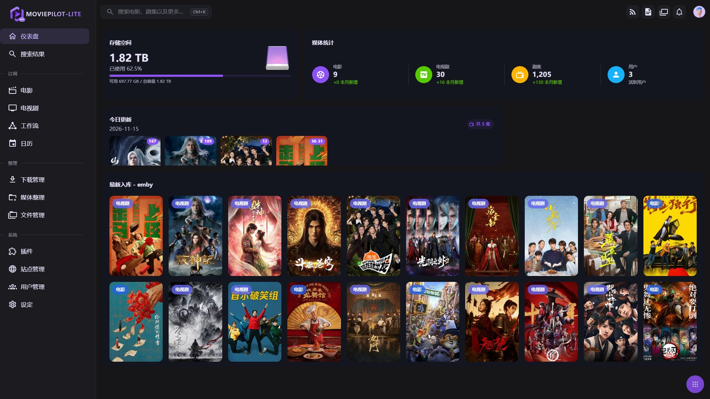
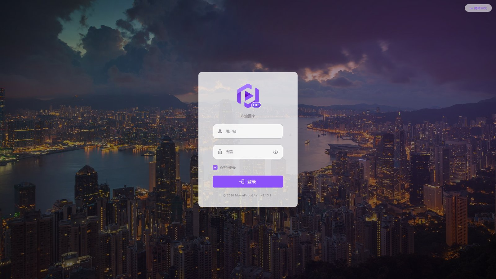

# MoviePilot-Lite

[](https://github.com/xyswordzoro/MoviePilot-LITE/pkgs/container/moviepilot-lite)
[](LICENSE)

简体中文 | 基于 [MoviePilot](https://github.com/jxxghp/MoviePilot) v2 的精简定制版。

聚焦自动化核心流程（订阅、搜索、下载、整理、刮削、媒体库刷新、消息通知），移除 AI Agent / LLM 子系统与分享上报，并加入站点日志、订阅分类分组、今日更新等轻量增强。

> 仅用于学习交流使用，请勿在任何国内平台宣传该项目。

## 界面预览

| | |
| --- | --- |
|  |  |
| **仪表盘**：媒体统计、今日更新、最新入库 | **订阅分组**：动漫 / 电视剧按分类自动分组，进度一目了然 |
|  |  |
| **站点日志**：按站点记录每次 RSS 刷新与识别明细 | **登录页**：Bing 每日壁纸 + 暗色 LITE 皮肤 |

## 主要特性

- 前后端一体：后端 FastAPI，前端 Vue 3 + Vuetify，构建产物随仓库分发
- 订阅 / 搜索 / 下载 / 整理 / 刮削 / 媒体库刷新 / 消息通知完整保留
- 下载器、媒体服务器、元数据源、消息渠道、插件与工作流能力保持兼容
- **订阅分类分组**：订阅页按媒体分类（动漫 / 电视剧）自动分组展示，卡片采用 backdrop 背景 + 进度条设计
- **站点日志**：按站点记录每次 RSS 刷新的种子名称与识别结果，支持站点切换、分页与自动刷新；RSS 刷新明细自动让位给站点日志，主日志保持清爽
- **今日更新**：仪表盘卡片直接对接订阅日历，展示当天更新的剧集与集数，已入库条目显示绿点
- **LITE 轻量界面**：扁平化亮 / 暗色皮肤，细边卡片、紧凑顶栏、淡紫选中态；日志 / 站点日志一键直达
- **登录页壁纸**：支持 Bing 每日壁纸（`WALLPAPER=bing`）、媒体服务器海报、TMDB 趋势与自定义接口
- **日志精简**：订阅刷新、媒体库同步、插件加载等仅保留单行汇总，明细降为 DEBUG；主日志内置重启分隔线
- **会话稳定**：签名密钥持久化，容器重启后登录态与图片签名 URL 不失效

## 与上游的差异

**移除**

- AI Agent / LLM / MCP 全部代码与接口
- 推荐 / 探索模块及对应前端入口
- 订阅分享、热门分享、工作流分享，以及统计上报开关

**新增**

- `app/helper/site_log.py` 与 `app/assets/site_log.html`：站点日志系统
- `GET /api/v1/dashboard/today`：今日更新数据（含入库状态）
- 订阅列表媒体分类（动漫 / 电视剧）与分组卡片视图
- 仪表盘「今日更新」卡片与前端 LITE 皮肤
- RSS 日志静默范围与单行汇总（`RSS_LOG_ENABLE` 开关控制）
- `start-lite.cmd` / `scripts/start_lite.py`：本地启动脚本，固定配置目录并载入 `app.env`

## 快速开始

### Docker

```bash
docker run -d \
  --name moviepilot-lite \
  -p 3000:3000 \
  -p 3001:3001 \
  -v /path/to/config:/config \
  --restart unless-stopped \
  ghcr.io/xyswordzoro/moviepilot-lite:latest
```

首次启动后访问 `http://<ip>:3000`，默认账号 `admin`，密码见容器日志或通过 `SUPERUSER_PASSWORD` 指定。

站点认证等变量写入 `config/app.env`，启动时自动载入进程环境：

```ini
AUTH_SITE="iyuu"
IYUU_SIGN="your-iyuu-sign"
API_TOKEN="your-api-token"
PROXY_HOST=""   # 可选，按需填写代理地址
WALLPAPER="bing"   # 登录页壁纸：bing / mediaserver / tmdb / customize
```

### 本地运行

Windows：

```bat
venv\Scripts\python -m pip install -r requirements.in
start-lite.cmd
```

Linux / macOS：

```bash
venv/bin/python -m pip install -r requirements.in
./scripts/start-local.sh backend
```

本地启动脚本会固定 `CONFIG_DIR`（默认 `~/.config/moviepilot-upstream-v2`），避免误建空配置库。

## 构建镜像

```bash
docker build -f docker/Dockerfile -t moviepilot-lite:latest .
```

- 镜像构建优先使用仓库内置的 `public/`（LITE 前端产物），缺失时回退下载官方前端
- 推送 `main` 分支或手动触发 `MoviePilot-LITE Image` 工作流，会自动构建并推送到 `ghcr.io/<owner>/moviepilot-lite`

## 目录说明

| 目录 | 说明 |
| --- | --- |
| `app/` | 后端主程序（FastAPI） |
| `app/assets/site_log.html` | 站点日志独立页面 |
| `docs/screenshots/` | README 界面截图 |
| `public/` | 构建好的 LITE 前端产物 |
| `docker/` | Dockerfile 与容器启动脚本 |
| `scripts/` | 本地启动、站点适配采集等工具 |
| `tests/` | 后端单元测试 |

更多开发文档见 [docs/](docs/)：本地环境、测试、CLI、站点适配采集等。

## 相关项目

- [MoviePilot](https://github.com/jxxghp/MoviePilot)
- [MoviePilot-Frontend](https://github.com/jxxghp/MoviePilot-Frontend)
- [MoviePilot-Plugins](https://github.com/jxxghp/MoviePilot-Plugins)
- [MoviePilot-Resources](https://github.com/jxxghp/MoviePilot-Resources)

## 免责申明

- 本软件仅供学习交流使用，任何人不得将本软件用于商业用途，任何人不得将本软件用于违法犯罪活动，软件对用户行为不知情，一切责任由使用者承担。
- 本软件基于开源代码修改，因修改、分发、传播造成的责任由修改发布者承担，不建议对用户认证机制进行规避或修改并公开发布。
- 本项目不接受捐赠，软件本身不收费也不提供任何收费相关服务，请仔细辨别避免误导。

## License

[GPL-3.0](LICENSE)
